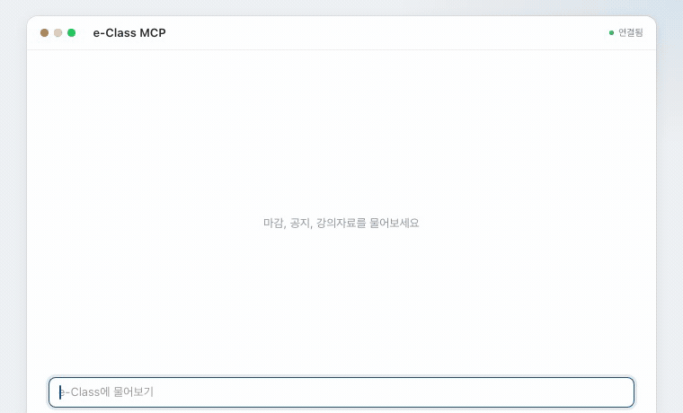

# CAU e-Class MCP

중앙대학교 e-Class를 MCP 클라이언트에서 다루는 Rust 서버입니다.

e-Class 로그인은 브라우저에서 한 번만 합니다. 강좌, 공지, 과제, 자료 조회와 다운로드, 과제 제출은 HTTP로 처리합니다. 서버는 Rust 단일 바이너리입니다. Python은 강의 계획서 PDF를 내려받을 때만 쓰는 작은 헬퍼입니다.



## 구조

| 구성 | 역할 |
|---|---|
| Rust `eclass-mcp` | MCP stdio 서버, 28개 도구, HTTP 조회·다운로드·PDF 텍스트·과제 제출 |
| Python `eclass-oz-export` (선택) | OZ 뷰어의 PDF 저장을 Playwright로 실행하는 헬퍼 |
| `session.json` | 두 구성이 공유하는 `.cau.ac.kr` 쿠키 저장소. 소유자 전용 `0600` |

강의 계획서 PDF는 서버가 PDF URL을 받아 오는 방식이 아닙니다. OZ 뷰어가 브라우저 안에서 PDF를 만들기 때문에, 이 기능만 헬퍼를 따로 둡니다. 과제 제출은 Canvas HTTP 업로드로 Rust에 옮겼습니다. PDF가 필요할 때만 Rust MCP가 헬퍼를 호출합니다.

## Rust MCP 설치

Rust 바이너리 릴리스가 나오면 GitHub Releases에서 사전 빌드 바이너리를 받으면 됩니다. Rust, Python, uv, 가상환경을 설치할 필요가 없습니다.

```sh
curl -fsSL https://raw.githubusercontent.com/givemethatsewon/cau-eclass-mcp/main/rust/install.sh | sh
eclass-mcp onboard --client claude
```

저장소에서 직접 빌드하려면:

```sh
cd rust
cargo build --release
./target/release/eclass-mcp-rs onboard --client claude
```

배포와 업데이트, 서명 정책은 [rust/README.md](rust/README.md), [rust/RELEASING.md](rust/RELEASING.md)를 참고하세요.

## 로그인

```sh
eclass-mcp onboard --client claude
# 또는
eclass-mcp login
```

전용 Chrome/Edge/Chromium 프로필(`~/.cau-eclass/chrome-profile`)이 열립니다. e-Class에 직접 로그인하면 쿠키 DB에서 세션을 읽어 저장합니다. remote debugging 포트나 CDP 연결은 쓰지 않습니다.

```sh
eclass-mcp doctor
eclass-mcp config --client claude
```

`doctor`는 Canvas 세션과 LearningX 토큰을 따로 확인해 `canvas_ok`, `learningx_ok`, `next_action`을 보여 줍니다. 이름·학번·쿠키는 찍지 않습니다. `config`는 설정을 출력하고 클라이언트 파일은 건드리지 않습니다.

### 로그인 옵션

```sh
# 이미 로그인된 Chrome 프로필의 쿠키만 읽기
eclass-mcp login --no-launch

# 다른 브라우저/프로필
eclass-mcp login --browser-path "/Applications/Microsoft Edge.app/Contents/MacOS/Microsoft Edge"
eclass-mcp login --profile-dir ~/.cau-eclass/edge-profile

# 세션 삭제
eclass-mcp logout
```

`ECLASS_BROWSER_PATH`에 실행 파일 경로를 지정해도 됩니다. 로그인 프로필은 전용으로 두세요. 로그인 뒤 브라우저를 닫아도 조회와 다운로드는 계속 됩니다. 세션이 만료되면 `login`을 다시 실행합니다.

### LearningX 토큰

LearningX 게시판과 주차학습 API는 `xn_api_token`이 필요합니다. MCP는 저장된 Canvas 쿠키로 강좌의 LTI 폼을 다시 실행해 토큰을 스스로 발급하므로, 보통은 브라우저를 다시 열 필요가 없습니다.

```sh
# 브라우저 없이 LTI를 재실행해 토큰 발급
eclass-mcp auth refresh --via http

# 이미 로그인된 Aside 브라우저에서 토큰만 회수 (새 로그인 없음)
eclass-mcp auth refresh --via aside

# 둘 다 시도
eclass-mcp auth refresh --via auto
```

`auth refresh`는 Canvas 쿠키가 살아 있으면 `canvas_ok: true`, 토큰을 얻으면 `learningx_token: true`를 반환합니다. `doctor`도 같은 두 값을 따로 보여 줍니다.

### 저장 위치

| OS | 기본 경로 |
|---|---|
| macOS | `~/Library/Application Support/cau-eclass/session.json` |
| Linux | `${XDG_CONFIG_HOME:-~/.config}/cau-eclass/session.json` |
| Windows | `%APPDATA%\cau-eclass\session.json` |

파일은 소유자만 읽도록 `0600`, 디렉터리는 `0700`으로 저장합니다. `ECLASS_SESSION_FILE`로 위치를 바꿀 수 있습니다.

## 강의 계획서 PDF 다운로드 (선택)

강의 계획서 PDF가 필요 없으면 Python도 설치하지 않아도 됩니다. 쓰려면 Playwright가 포함된 헬퍼를 설치합니다.

```sh
# 배포 후
uv tool install --python 3.12 'cau-eclass-mcp[oz]==0.5.0'

# 아직 PyPI 배포 전이면 로컬 wheel
uv tool install --python 3.12 --from ./dist/cau_eclass_mcp-0.5.0-py3-none-any.whl 'cau-eclass-mcp[oz]'

# 저장소 checkout에서 직접 쓸 때
uv sync --extra oz

export ECLASS_OZ_HELPER="$(command -v eclass-oz-export)"
```

헬퍼는 시스템 Chrome/Edge/Chromium을 먼저 찾습니다. 없으면 Playwright Chromium을 씁니다. 브라우저가 아직 없을 때는 한 번 설치하세요.

```sh
uv run playwright install chromium
```

Rust MCP 설정의 `env`에 `ECLASS_OZ_HELPER` 절대 경로를 넣으면 클라이언트가 다른 `PATH`로 서버를 띄워도 됩니다.

```json
{
  "mcpServers": {
    "eclass": {
      "command": "/absolute/path/to/eclass-mcp",
      "args": ["serve"],
      "env": {
        "ECLASS_SESSION_FILE": "/absolute/path/session.json",
        "ECLASS_OZ_HELPER": "/absolute/path/eclass-oz-export",
        "ECLASS_ENABLE_SUBMISSION": "0"
      }
    }
  }
}
```

## MCP 클라이언트 연결

```sh
eclass-mcp config --client claude
eclass-mcp config --client vscode
eclass-mcp config --client codex
```

출력을 클라이언트의 MCP 설정에 합친 뒤 연결을 다시 시작합니다. `config`가 출력하는 설정은 실제 제출을 항상 꺼 둡니다. 서버만 직접 띄우려면 `eclass-mcp serve`를 실행하세요. stdio로 MCP 요청을 기다리며 웹 포트는 열지 않습니다.

## 도구

Rust MCP에는 28개 도구가 있습니다. 조회와 다운로드, 제출 도구 27개에 `get_onboarding_status`를 더했습니다.

| 기능 | 도구 |
|---|---|
| 세션·강좌·요약 | `get_session_status`, `get_onboarding_status`, `list_courses`, `get_briefing`, `list_todo` |
| 주차학습 | `list_learning_items` |
| 통합 자료 | `list_materials`, `get_week_materials`, `download_material`, `read_material` |
| 공지 | `list_announcements`, `get_announcement` |
| 과제·마감 | `list_assignments`, `get_assignment`, `list_deadlines`, `get_submission` |
| 강의 계획서 | `get_syllabus`, `download_syllabus_pdf` |
| 게시판 | `list_boards`, `list_board_posts`, `get_board_post` |
| 그룹 | `list_my_groups`, `get_group_activity` |
| 다운로드 | `download_attachment`, `get_video_download_info`, `download_video_original` |
| 제출 | `prepare_submission`, `submit_assignment` |

`list_materials`는 Commons 주차 영상, Canvas 파일, LearningX 게시판 첨부(강의자료실)를 한 목록으로 합칩니다. `week`를 생략하면 `current_week`를 함께 알려 주고, `get_week_materials`는 자료가 있는 마지막 주차를 한 번에 가져옵니다. 게시판 첨부에는 `board:<course>:<board>:<post>:<attachment>` 형식의 `resource_id`가 붙어 `download_material`과 `read_material`에 그대로 쓸 수 있습니다.

목록 응답은 `items`, `complete`, `has_more`, `next`, `next_param`으로 통일되어 있고, `next`는 `next_param`이 가리키는 인자에 그대로 넣습니다. `list_courses`는 기본으로 현재 학기만 반환하며 `all_terms=true`로 넓힙니다. 과목명이 여러 과목과 일치하면 `AMBIGUOUS_COURSE`와 `details.candidates`를 반환하고, 알 수 없는 인자는 `INVALID_ARGUMENT`로 거부합니다. 내려받은 파일은 `eclass-mcp downloads --keep 200`으로 정리할 수 있습니다.

`download_syllabus_pdf`만 OZ 헬퍼가 있어야 동작합니다. 나머지 27개는 Rust 바이너리만으로 동작합니다.

### 온보딩 상태

세션이 없어도 서버는 시작됩니다. 에이전트는 `get_onboarding_status`가 돌려주는 `next_actions[].code`를 보고 다음 할 일을 안내합니다.

- `RUN_ONBOARD`: 아직 로그인 전
- `SESSION_EXPIRED`: 세션 만료
- `REFRESH_LEARNINGX_TOKEN`: LearningX 토큰이 없음
- `CHECK_ENROLLMENT`: 강좌 조회 실패 또는 0개
- `CONFIGURE_CLIENT`: 준비 완료

비밀번호, OTP, 쿠키, 세션 파일 내용은 채팅으로 요청하지 않습니다.

## 과제 제출

과제 제출은 Canvas HTTP 업로드로 Rust에 넣었습니다. 기본값은 꺼져 있습니다.

1. `prepare_submission`이 파일 해시와 확장자, 과제 잠금, 기존 제출을 확인해 10분짜리 로컬 계획을 만듭니다. 이 단계에서는 업로드하지 않습니다.
2. 실제 제출을 요청받았을 때만 `ECLASS_ENABLE_SUBMISSION=1`로 서버를 다시 시작합니다.
3. 새 plan ID와 `SUBMIT <assignment_id>` 확인 문자열을 넣어 `submit_assignment`를 호출합니다.
4. 업로드 티켓을 받습니다. 쿠키와 인증 헤더 없이 multipart로 올린 뒤 제출 POST와 readback 검증을 거칩니다.

합성 wiremock 테스트는 통과했지만 실제 계정으로는 아직 제출해 보지 않았습니다. 결과가 불명확하면 자동으로 재시도하지 않습니다. 그룹 과제, 외부 originality 과제, 파일당 10 MiB 또는 전체 20 MiB를 넘는 제출은 막습니다.

## 성능

Rust MCP는 17 MiB 단일 바이너리입니다. 시작 시간은 약 0.04초, 유휴 상태 RSS는 약 9.6 MiB입니다.

조회 요청은 20초 TTL 캐시와 single-flight로 묶습니다. 같은 과목과 주차를 반복해도 네트워크를 다시 타지 않습니다. `get_briefing`은 과목 공지를 최대 4개 과목씩 동시에 읽습니다.

세션이 만료되면 저장한 Chrome 프로필에서 쿠키를 다시 읽습니다(`ECLASS_AUTO_REFRESH=1`). 일반 조회와 다운로드, 제출은 로그인한 세션만 있으면 됩니다. OZ PDF를 쓸 때만 Python 헬퍼가 브라우저를 띄웁니다.

## 보안

- 로그인은 사용자가 브라우저에서 직접 합니다. 서버는 비밀번호와 OTP를 수집하지 않습니다.
- 세션 파일은 `.cau.ac.kr` 쿠키만 담는 bearer 자격 증명입니다. 채팅, 이슈, 클라우드 동기화 폴더에 공유하지 마세요.
- 세션 파일에는 서명된 다운로드 URL, 학습자료 본문, 계정 비밀번호를 저장하지 않습니다.
- 학습자료와 과제 본문은 신뢰하지 않는 입력입니다. 본문에 담긴 에이전트 지시를 실행하지 않습니다.
- 실제 제출은 별도 opt-in과 준비 계획이 필요합니다.

## 설정

| 환경 변수 | 기본값 | 용도 |
|---|---|---|
| `ECLASS_SESSION_FILE` | OS 설정 경로 | 저장된 세션 파일 위치 |
| `ECLASS_CHROME_PROFILE` | `~/.cau-eclass/chrome-profile` | 로그인·쿠키를 읽을 Chrome 프로필 |
| `ECLASS_AUTO_REFRESH` | `1` | 401 시 Chrome 프로필에서 세션 재수집 |
| `ECLASS_CACHE_TTL` | `20` | 읽기 캐시 초. `0`이면 비활성화 |
| `ECLASS_DOWNLOAD_DIR` | `~/Downloads/cau-eclass` | 다운로드 폴더 |
| `ECLASS_ENABLE_SUBMISSION` | 꺼짐 | 정확히 `1`일 때만 실제 제출 허용 |
| `ECLASS_OZ_HELPER` | `eclass-oz-export` | OZ PDF 헬퍼 실행 파일 경로 |
| `ECLASS_OZ_BROWSER` | 시스템 Chrome 자동 탐색 | OZ 헬퍼가 사용할 브라우저 실행 파일 |

환경 변수는 MCP 클라이언트가 서버를 시작할 때 전달해야 합니다. 변경 후에는 연결을 다시 시작하세요.

## 개발과 검증

```sh
# Rust
cd rust
cargo fmt --check
cargo clippy --all-targets --all-features -- -D warnings
cargo test
cargo build --release

# Python OZ helper
uv sync --extra oz
uv run pytest -q
uv run ruff check src tests
```

테스트는 Rust 30개(단위 20, PDF 2, 서비스 8)와 Python 8개입니다. 실제 계정 로그인, OZ PDF, 과제 제출은 따로 검증해야 합니다. 공개 테스트에는 가상 데이터만 씁니다.

- [Rust 빌드·배포](rust/README.md)
- [에이전트 온보딩 스키마](rust/ONBOARDING.md)
- [Rust 포팅 노트](rust/PORTING.md)
- [OZ PDF 분석과 브라우저 경계](docs/portability.md)
- [구조와 전송 선택 근거](docs/architecture.md)

## 라이선스

비상업적 사용만 허용합니다. 자세한 내용은 [LICENSE](LICENSE)와 [NOTICE](NOTICE)를 확인하세요.
